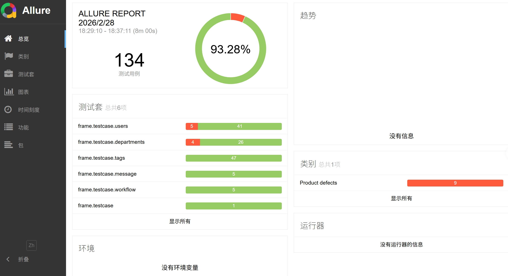
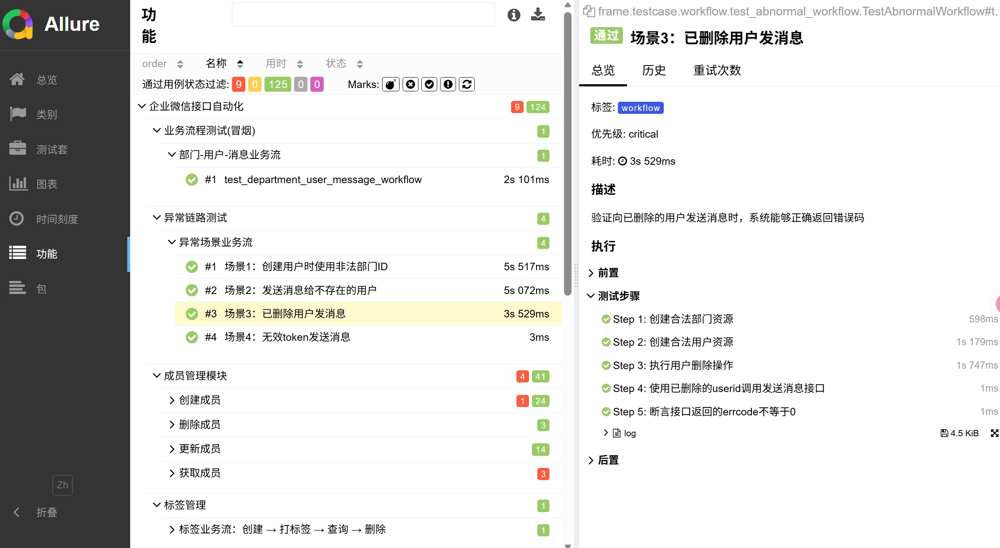
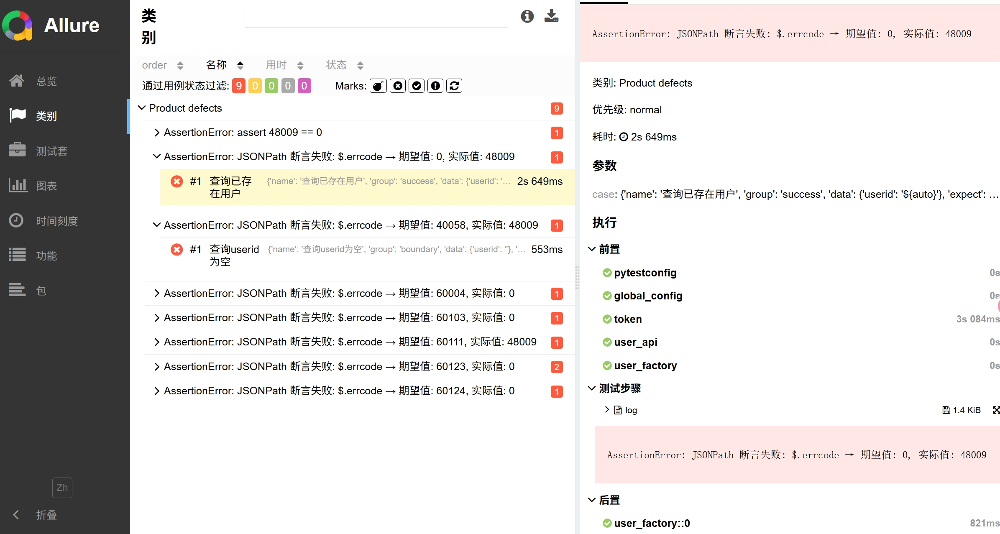
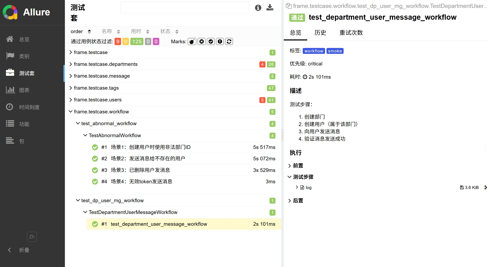

# 基于 pytest 的轻量级 API 自动化测试框架

基于 **Python + pytest + requests** 构建的轻量级 API 自动化测试框架，以**企业微信开放接口**作为测试场景，覆盖部门、用户、标签、消息等核心模块，包括数据驱动、fixture 工厂管理、业务流测试、异常链路测试、日志收集以及测试数据的自动准备和清理，并在原有项目基础上进行了通用化整理和结构优化。

## 项目背景

- **项目简介**：基于 Python + pytest + requests 的轻量级 API 自动化测试框架；测试场景：企业微信通讯录管理和消息发送核心业务
- **技术栈**：pytest + requests + allure + PyYAML + jsonschema + jsonpath
- **Python 版本**：Python 3.13.6
- **项目版本**：v1.3.0

##  测试概览

- 接口自动化用例：134 条（单接口参数化 + 业务流 + 异常链路）
- 框架层单元测试：14 条（不依赖网络与真实企业微信环境）
- 已接入 Allure 可视化报告

###  主要测试
-  各个模块单接口参数化测试（YAML 数据驱动）
-  各模块多接口依赖业务流测试
-  各模块多接口依赖异常链路验证

### 报告截图







## 项目能力

- **pytest 测试框架**：支持 fixture（获取 API 实例和 token）、参数化、标记；requests 库（http 客户端库）
- **分层设计**：APIs 层（接口封装）、Common 层（通用工具）、Testcase 层（测试用例）三层架构，提升复用性和可维护性
- **通用 HTTP 与业务解耦**：`BaseApi` 只封装通用 HTTP 请求能力；`WeComApi` 继承 `BaseApi`，处理企业微信 access_token 失效检测、强制刷新和单次重试
- **业务 API 封装**：部门、用户、标签、消息等模块接口统一封装，token 统一通过 `params` 传递
- **YAML 数据驱动**：支持多模块的创建、查询、更新、删除用例全部数据驱动，`${auto}` 占位符自动生成唯一测试数据
- **Fixture 工厂管理**：`department_factory`、`user_factory`、`tag_factory` 实现资源生命周期管理和自动清理
- **多环境切换**：通过 `pytest --env dev/prod` 命令行参数切换测试环境
- **敏感配置治理**：真实密钥通过本地 `.env` 文件或系统环境变量读取，仓库中仅保留占位符
- **日志封装**：统一的 logger 封装，支持请求/响应日志记录，URL 中的 token 自动脱敏
- **jsonpath/Schema 校验**：设计统一断言机制，结合 jsonpath / jsonschema 对接口响应字段与结构校验
- **Allure 报告**：完整的 epic/feature/story/step 注解体系
- **CI（持续集成）**：基于 GitHub Actions，push 时自动运行冒烟测试并上传 Allure 结果

## 项目目录结构

```
auto_interface/
├── pytest.ini                          # pytest 全局配置（addopts / testpaths / markers / log_cli）
├── conftest.py                         # 根级 conftest：注册 --env 参数，会话级切换环境配置
├── requirements.txt                    # 项目依赖
├── .env.example                        # 敏感配置示例（真实密钥放本地 .env，不提交仓库）
├── .github/workflows/ci.yml            # CI：push 触发冒烟测试并上传 Allure 结果
│
├── frame/                              # 框架核心代码
│   ├── apis/                           # API 请求封装层
│   │   ├── base_api.py                 # BaseApi：通用 HTTP 请求基类
│   │   ├── weixin_base.py              # WeComApi：企业微信 Token 失效检测、刷新与单次重试
│   │   ├── contacts/                   # 通讯录接口
│   │   │   ├── departments.py          # 部门管理接口
│   │   │   ├── users.py                # 用户管理接口
│   │   │   └── tags.py                 # 标签管理接口
│   │   └── message/                    # 消息接口
│   │       └── message.py              # 消息发送接口
│   │
│   ├── common/                         # 公共组件层
│   │   ├── config.py                   # 配置管理（yaml + 环境变量 + .env）
│   │   ├── token_get.py                # access_token 获取与模块级缓存
│   │   ├── logger.py                   # 日志封装
│   │   ├── assertions.py               # JSONPath 断言
│   │   ├── schema.py                   # JSON Schema 校验
│   │   └── utils/tools.py              # 工具函数（YAML 加载）
│   │
│   ├── config/                         # 环境配置
│   │   ├── test_env.yaml               # 测试环境配置
│   │   ├── dev.yaml                    # 开发环境配置
│   │   ├── prod.yaml                   # 生产环境配置
│   │   └── settings.py                 # 模块开关配置
│   │
│   ├── datas/                          # 数据驱动目录（YAML 测试数据）
│   │   ├── departments.yaml            # 部门模块测试数据
│   │   ├── users.yaml                  # 用户模块测试数据
│   │   ├── tags.yaml                   # 标签模块测试数据
│   │   └── send_message.yaml           # 消息发送测试数据
│   │
│   ├── schema/                         # JSON Schema 校验目录
│   │   ├── department_schema.json      # 部门响应结构校验
│   │   ├── users_schema.json           # 用户响应结构校验
│   │   └── tag_schema.json             # 标签响应结构校验
│   │
│   ├── testcase/                       # 测试用例层（pytest）
│   │   ├── conftest.py                 # fixture（token、API 实例、factory）与 ${auto} 占位符处理
│   │   ├── departments/               # 部门模块测试用例
│   │   │   ├── test_departments.py     # 单接口测试（数据驱动）
│   │   │   └── test_department_flow.py # 业务流测试（创建→查询→更新→删除）
│   │   ├── users/                      # 用户模块测试用例
│   │   │   ├── test_users.py           # 单接口测试（数据驱动）
│   │   │   └── test_user_flow.py       # 业务流测试（创建→查询→更新→删除）
│   │   ├── tags/                       # 标签模块测试用例
│   │   │   ├── test_tags.py            # 单接口测试（数据驱动）
│   │   │   └── test_tag_flow.py        # 业务流测试（创建标签→创建用户→打标→校验→清理）
│   │   ├── message/                   # 消息模块测试用例
│   │   │   └── test_send_message.py    # 消息发送测试（数据驱动）
│   │   ├── workflow/                   # 跨模块业务流测试
│   │   │   ├── test_dp_user_mg_workflow.py    # 部门-用户-消息业务流
│   │   │   └── test_abnormal_workflow.py       # 异常链路测试
│   │   ├── unit/                       # 框架层单元测试（不依赖网络）
│   │   │   ├── test_base_api.py        # BaseApi 单元测试
│   │   │   └── test_weixin_api.py      # WeComApi Token 失效重试专项测试
│   │   └── test_env_switch.py          # 环境切换验证用例
│   │
│   └── logs/                           # 日志输出目录（运行时自动生成）
│
├── docs/                                # 架构与改造记录文档
├── allure-results/                     # Allure 测试结果目录（运行时自动生成）
├── allure-report/                      # Allure 测试报告目录（自动生成）
└── README.md                           # 项目说明文档
```

## 核心设计亮点

### 1.  三层架构与两级继承设计

采用经典的分层架构，职责清晰，易于维护和扩展。

- **APIs 层**：封装企业微信各模块接口，统一继承 `WeComApi`，避免重复代码
- **Common 层**：提供日志、断言、配置等通用能力，支持复用
- **Testcase 层**：基于 pytest 的测试用例，支持数据驱动和 fixture 注入

继承链：`BaseApi`（通用 HTTP 请求）→ `WeComApi`（企业微信 Token 处理）→ 各业务类。通用 HTTP 能力与企业微信业务逻辑完全分离，`BaseApi` 不依赖任何业务模块。

例：创建部门接口封装
```python
class Departments(WeComApi):
    def create(self, data):
        req = {
            "method": "POST",
            "url": f"{self.base_url}/department/create",
            "params": {"access_token": self.token},
            "json": data
        }
        return self.send_api(req)
```

### 2.  Token 自动获取与失效重试

`WeComApi` 在通用 HTTP 能力之上实现 token 自愈：请求后检测响应中的企业微信失效错误码（40014/42001），命中则强制刷新 token、回写实例并重试一次。

```python
class WeComApi(BaseApi):
    TOKEN_EXPIRED_CODES = {40014, 42001}    # token 失效错误码

    def send_api(self, req):
        r = super().send_api(req)           # 复用通用 HTTP 发送逻辑
        if not self._is_token_expired(r):
            return r
        new_token = fetch_token(force=True)  # 强制刷新并回写实例
        self.token = new_token
        retry_req = copy.deepcopy(req)      # 深拷贝重试请求，不污染原始数据
        retry_req["params"] = dict(req.get("params") or {})
        retry_req["params"]["access_token"] = new_token
        return super().send_api(retry_req)   # 重试一次（无论结果不再重试）
```

**优势**：
- token 失效自动重试，无需人工干预；重试最多 1 次，防止请求风暴
- `token_get.py` 模块级缓存：会话内多个 API 实例共享 token，失效刷新只触发一次真实请求
- 重试请求深拷贝构造，代理配置等请求参数与原请求完全一致

### 3.  Fixture 工厂模式

通过 factory fixture 实现资源的统一创建和自动清理，避免测试数据污染。
例：
```python
@pytest.fixture
def department_factory(department_api):
    created_ids = []

    def _create(data):
        processed_data = replace_auto_placeholder(data)
        res = department_api.create(processed_data)
        dep_id = res.json().get("id")
        if dep_id:
            created_ids.append(dep_id)
        return res

    factory = SimpleNamespace(create=_create, created_ids=created_ids)
    yield factory
    _cleanup_created(department_api.delete, created_ids, "部门")
```

**优势**：
- 资源生命周期管理自动化，测试用例无需手动编写清理代码
- 三个工厂统一通过 `factory.create(data)` 调用，`created_ids` 记录已创建资源
- 清理时单条删除失败不影响其余资源，尽可能恢复环境

### 4.  YAML 数据驱动

测试数据与测试代码分离，支持快速扩展和维护。
例：
```yaml
create_department:
  - name: 正常创建部门
    group: success
    data:
      name: "${auto}"
      parentid: "${auto}"
    expect:
      errcode: 0
```

**优势**：测试数据集中管理，支持分组标记，使用 `${auto}` 占位符自动生成唯一数据。占位符处理由统一的公共引擎和各业务规则表实现，部门/用户/标签的替换规则相互独立。

### 5. Allure 报告集成

完整的 Allure 注解体系，生成可视化测试报告。

```python
@allure.epic("企业微信接口自动化")
@allure.feature("部门管理")
@allure.story("部门业务流")
@allure.severity(allure.severity_level.CRITICAL)
@pytest.mark.workflow
def test_department_business_flow(self, department_api):
    with allure.step("Step 1: 创建部门"):
```

**优势**：多维度测试分类，步骤级别的测试记录，支持严重程度标记。


## 测试覆盖范围

### 部门模块

创建、查询、更新、删除部门，业务流测试（创建 → 查询 → 修改 → 再查询 → 删除）

### 用户模块

创建、查询、更新、删除用户，业务流测试（创建 → 查询 → 修改 → 确认修改 → 删除）

### 标签模块

创建、查询、更新、删除标签，业务流测试（创建标签 → 创建用户 → 打标签 → 查询校验 → 删除标签 → 删除用户）

### 消息模块

发送文本消息的正常场景与异常场景（接收方不存在、接收方为空、内容为空等）

### 业务流测试

部门-用户-消息业务流（创建部门 → 创建用户 → 发送消息），异常链路测试（非法部门 ID、已删除用户等异常场景）

## 运行方式

### 1. 安装依赖

```bash
pip install -r requirements.txt
```

### 2. 配置环境

```bash
# 复制示例文件为本地 .env，填入真实企业微信 corpid / corpsecret（.env 不会被提交）
cp .env.example .env
```

也可以通过系统环境变量 `WECOM_CORPID` / `WECOM_CORPSECRET` 注入（优先级高于 .env 文件）。`frame/config/*.yaml` 中仅保留占位符。

注意：运行真实接口测试需要将运行机器的出口 IP 加入企业微信应用的可信 IP 列表。

### 3. 运行测试

```bash
# 运行所有测试
pytest

# 切换测试环境（默认 test_env）
pytest --env dev
pytest --env prod

# 运行指定模块
pytest frame/testcase/departments/
pytest frame/testcase/users/
pytest frame/testcase/tags/
pytest frame/testcase/message/

# 运行跨模块业务流测试
pytest frame/testcase/workflow/

# 运行框架层单元测试（不依赖网络与真实环境）
pytest frame/testcase/unit/
```

### 4. 生成 Allure 报告

```bash
pytest --alluredir ./allure-results
allure generate ./allure-results -o ./allure-report --clean
allure open ./allure-report
```

## 项目特色

### 1. 数据驱动测试

测试数据与测试代码分离，支持 YAML 格式的测试数据，使用 `${auto}` 占位符自动生成唯一数据。

### 2. 自动化数据准备与清理

测试前自动创建所需的部门、用户、标签，测试后自动清理创建的测试资源，支持重复执行，避免数据污染。

### 3. 多维度测试覆盖

单接口测试（正常场景、边界场景、异常场景），业务流测试（端到端业务场景），异常链路测试（验证异常处理能力），冒烟测试（核心业务可用性验证）。

### 4. 完善的日志体系

请求/响应日志记录，测试步骤日志记录，清理操作日志记录，支持日志级别配置。


### Q: 如何添加新的测试用例？

1. 在 `frame/datas/` 对应模块的 YAML 文件中添加测试数据
2. 在 `frame/testcase/` 对应模块的测试文件中添加测试方法
3. 使用 `@pytest.mark.parametrize` 进行参数化

## 版本历史

### v1.3.0（当前版本）

进行通用化整理与结构优化：`BaseApi` 与 `WeComApi` 分离（token 失效检测、强制刷新、单次重试、模块级缓存），统一 access_token 传递方式，修复多环境切换问题，敏感配置支持环境变量与本地 .env，占位符处理引擎化，三个 factory fixture 统一调用方式，新增框架层单元测试。

### v1.2.0

新增消息模块测试，新增业务流测试（部门-用户-消息），新增异常链路测试，采用factory fixture管理实现资源生命周期管理和自动清理，
完善 Allure 报告注解体系。

### v1.1.0

调整项目结构，采用三层架构，增加部门/用户/标签完整业务流，增强日志和断言能力，完整集成 Allure 报告。

### v1.0.0

初始版本发布，支持部门、用户、标签基础测试，支持 YAML 数据驱动，支持 fixture
