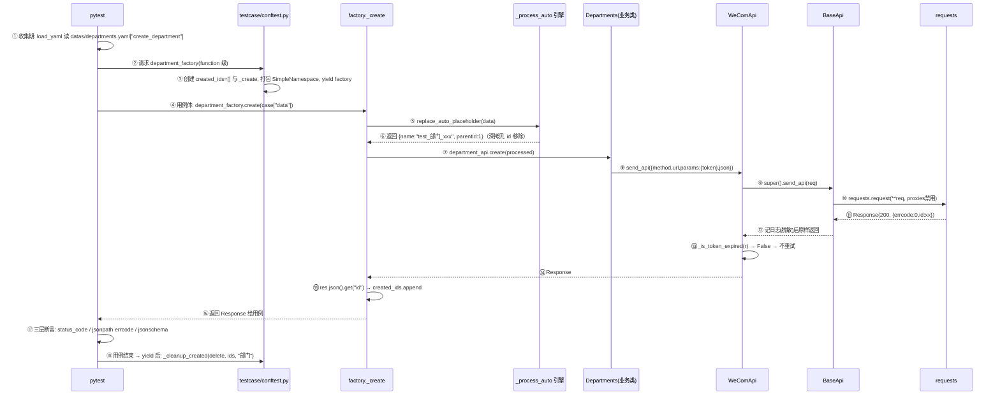
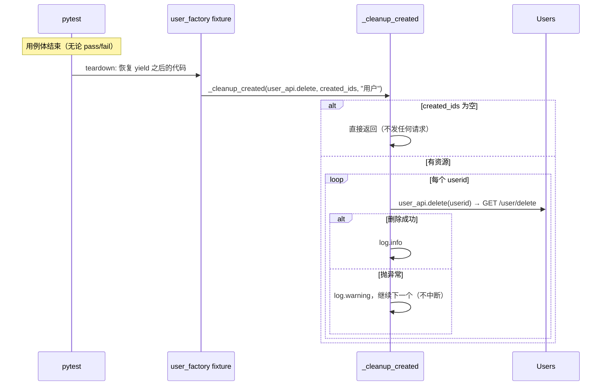
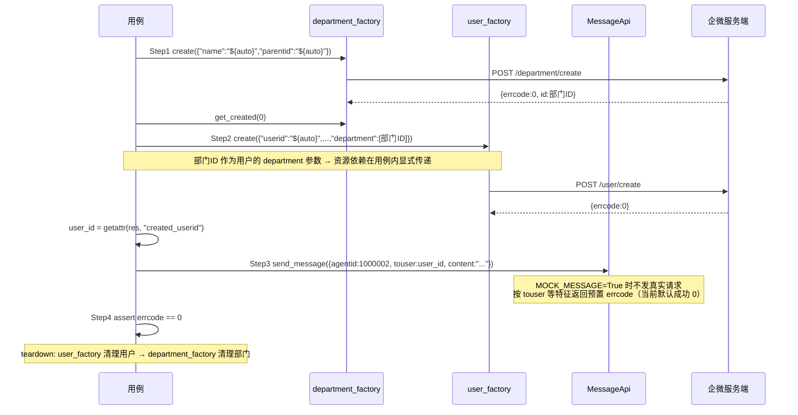

# 项目架构与源码精读指南（project-architecture-guide）

> 本文档基于对项目全部核心源码的逐文件阅读整理，所有描述均以实际代码为准，不引用 README 的说法。
> 阅读对象：写过本项目、但需要重新掌握设计细节和调用链的人。
> 标注约定：凡无法从代码确认的行为，均明确标注「需进一步确认」。

---

## 一、目录结构与分层架构

### 1.1 目录总览

```
auto_interface/
├── pytest.ini                    # pytest 全局配置（addopts/testpaths/markers/log_cli）
├── conftest.py                   # 根级 conftest：注册 --env 参数 + global_config fixture
├── requirements.txt              # 依赖清单（pytest/allure-pytest/requests/PyYAML/jsonschema/jsonpath）
├── .env.example                  # 敏感配置示例（真实密钥放本地 .env，已被 Git 忽略）
├── .github/workflows/ci.yml      # CI：pytest -m smoke + 上传 allure-results
└── frame/
    ├── apis/                      # ② API 请求封装层
    │   ├── base_api.py            #    BaseApi：通用 HTTP 请求基类（纯框架能力）
    │   ├── weixin_base.py         #    WeComApi：企业微信 Token 层（企微专属）
    │   ├── contacts/
    │   │   ├── departments.py     #    Departments：部门 CRUD
    │   │   ├── users.py           #    Users：成员 CRUD
    │   │   └── tags.py            #    Tags：标签 CRUD + 成员打标
    │   └── message/
    │       └── message.py         #    MessageApi：消息发送（含 mock 分支）
    ├── common/                    # ③ 公共组件层
    │   ├── config.py              #    Config/cf：yaml 配置 + 环境变量覆盖 + .env 加载
    │   ├── token_get.py           #    fetch_token：企微 access_token 获取（带模块级缓存）
    │   ├── logger.py              #    AutoTestLogger：控制台 + 按日期文件双输出
    │   ├── assertions.py          #    AssertUtil：jsonpath 断言
    │   ├── schema.py              #    SchemaValidator：jsonschema 结构校验
    │   └── utils/tools.py         #    load_yaml / get_frame_root
    ├── config/                    # 环境配置
    │   ├── test_env.yaml / dev.yaml / prod.yaml   # base_url/corpid/corpsecret（占位符，真实值走 .env）
    │   └── settings.py            #    MOCK_MESSAGE = True（消息模块 mock 开关）
    ├── datas/                     # ④ 测试数据层（YAML 参数化数据）
    │   ├── departments.yaml / users.yaml / tags.yaml / send_message.yaml
    ├── schema/                    # ⑤ 响应结构定义（jsonschema）
    │   ├── department_schema.json / users_schema.json / tag_schema.json
    └── testcase/                  # ① 测试用例层
        ├── conftest.py            #    全部 fixture + factory + 占位符处理函数
        ├── departments/  users/  tags/  message/          # 单接口测试
        │   ├── test_departments.py 等
        │   └── test_department_flow.py / test_user_flow.py / test_tag_flow.py  # 模块内业务流
        ├── workflow/
        │   ├── test_dp_user_mg_workflow.py   # 跨模块业务流（部门→用户→消息）
        │   └── test_abnormal_workflow.py    # 异常场景流
        ├── unit/                  # 框架层单元测试（不依赖网络）
        │   ├── test_base_api.py   #    BaseApi 4 条
        │   └── test_weixin_api.py #    WeComApi 10 条
        └── test_env_switch.py     # 环境切换验证用例
```

### 1.2 分层与职责

| 层 | 位置 | 职责 | 关键内容 |
|---|---|---|---|
| ① 测试用例层 | `frame/testcase/` | 只写「测试编排和断言」，不含 URL、不含请求构造 | 测试类、YAML 参数化、三层断言 |
| ② API 封装层 | `frame/apis/` | 把每个 HTTP 接口封装成 Python 方法；**不含断言** | BaseApi → WeComApi → 四个业务类 |
| ③ 公共组件层 | `frame/common/` | 配置、鉴权、日志、断言工具、数据加载 | cf、fetch_token、log、AssertUtil、load_yaml |
| ④ 测试数据层 | `frame/datas/` | 纯数据：name/group/data/expect 四段式 | 被 `load_yaml` 在收集期读入 |
| ⑤ 结构定义层 | `frame/schema/` | 响应结构契约 | jsonschema 校验文件 |

### 1.3 层间依赖关系（谁调用谁）

```
testcase（用例）
   │  依赖
   ├──→ apis（API 封装）：只通过 fixture 注入的实例调用，不直接 import 业务类
   ├──→ common/assertions、common/schema：断言
   ├──→ common/utils/tools.load_yaml：收集期加载参数化数据
   └──→ testcase/conftest：fixture 注入 + replace_auto_placeholder* 直接 import
apis（业务类）
   │  继承
   ├──→ weixin_base.WeComApi ──继承──→ base_api.BaseApi ──→ common.config.cf、common.logger
   └──→ common/token_get.fetch_token（仅 weixin_base 引用，BaseApi 不引用）
common
   ├── config.py：读 frame/config/*.yaml + 环境变量 + 根目录 .env
   ├── token_get.py：读 cf 的 corpid/corpsecret，requests.get(gettoken)
   └── logger/assertions/schema/tools：被上层调用，自身不依赖业务层
```

**依赖方向的铁律**（这是本项目解耦改造的成果）：
- BaseApi **不 import** 任何企微模块（有单测 `test_base_api_has_no_wecom_dependency` 做源码级守护）
- 只有 `weixin_base.py` 和 `token_get.py` 两个文件知道企业微信的鉴权细节
- 用例层反向依赖 conftest 的占位符函数（`from frame.testcase.conftest import replace_auto_placeholder_tag`）

### 1.4 通用能力 vs 企微业务 vs 具体用例

| 类别 | 内容 |
|---|---|
| **通用框架能力**（换掉企微也能复用） | BaseApi、Config/cf、logger、AssertUtil、SchemaValidator、load_yaml、pytest.ini 机制、`${auto}` 引擎骨架、`_cleanup_created` |
| **企业微信业务实现** | WeComApi（40014/42001）、token_get、Departments/Users/Tags/MessageApi、三个规则表（replace_auto_placeholder*）、settings.MOCK_MESSAGE |
| **具体测试用例** | testcase/ 下全部 test_*.py + datas/ 四个 yaml + schema/ 三个 json |

---

## 二、各层核心实现精读

### 2.1 API 请求封装层

#### BaseApi（`frame/apis/base_api.py`）——通用 HTTP 能力

```python
def _mask_url(url):
    # 日志脱敏：把 URL 中 access_token=xxx 替换为 access_token=***
    return re.sub(r"(access_token=)[^&]+", r"\1***", url)

class BaseApi:
    def __init__(self, token=None):
        self.token = token                  # token 只是一个待传递的字符串，基类不知道它是什么
        self.base_url = cf.get("base_url")  # 构造时从配置读基础地址

    def send_api(self, req):
        # req 是与 requests.request 参数一致的字典
        log.info(f"请求接口为：{_mask_url(req['url'])}")
        r = requests.request(**req, proxies={"http": None, "https": None})  # 禁用本地代理
        log.info(f"接口响应为：{r.text}")
        return r                            # 返回原始 Response，不假设是 JSON
```

设计要点：
1. **`send_api(req)` 收字典而非散参数**——这是整个框架「重试可复用」的前提：重试时只需要改字典里的一个键，其他（headers/json/proxies）原样保留。
2. **不解析响应体**——JSON 解析交给调用方；非 JSON 响应（网关 502 的 HTML 页）不会在框架层崩溃。
3. **token 只是普通属性**——`self.token` 由子类决定怎么用（企微放在 params 里，别的系统可以放 headers），基类零感知。
4. **`proxies={"http": None, "https": None}`**——本机开了代理（如 Clash）时避免 requests 读取系统代理环境变量导致请求走代理失败。

#### WeComApi（`frame/apis/weixin_base.py`）——企微鉴权自愈层

```python
class WeComApi(BaseApi):
    TOKEN_EXPIRED_CODES = {40014, 42001}    # 40014=不合法token, 42001=token过期

    def send_api(self, req):
        r = super().send_api(req)           # ① 先走通用层发请求
        if not self._is_token_expired(r):   # ② 判断响应是否表示 token 失效
            return r
        new_token = fetch_token(force=True)  # ③ 强制刷新（绕过缓存）
        self.token = new_token              # ④ 回写实例：后续请求直接用新 token
        retry_req = copy.deepcopy(req)      # ⑤ 深拷贝，不污染调用方的字典
        retry_req["params"] = dict(req.get("params") or {})
        retry_req["params"]["access_token"] = new_token
        return super().send_api(retry_req)  # ⑥ 重试一次（无论结果不再重试）

    def _is_token_expired(self, response):
        try:
            res_json = response.json()
        except ValueError:                  # 非 JSON 响应 → 无法判断 → 不重试
            return False
        return isinstance(res_json, dict) and res_json.get("errcode") in self.TOKEN_EXPIRED_CODES
```

设计要点：
1. **失效码做成类属性**——加新错误码改一处配置，不改逻辑。
2. **重试最多 1 次**——如果重试后仍失效就返回，防止请求风暴。
3. **`deepcopy` 防御**——req 是用例层/fixture 传进来的，原地修改会导致重试污染原始测试数据。
4. **`params` 为 None/缺失时 `dict(None or {})` 自动补齐**——避免 `None["access_token"]` 的 TypeError。
5. **重试复用 `super().send_api()`**——代理禁用、日志行为与原请求完全一致。

#### token_get（`frame/common/token_get.py`）——token 获取与缓存

```python
_token_cache = None    # 模块级缓存：整个进程共享

def fetch_token(force=False):
    global _token_cache
    if _token_cache and not force:      # 非强制 → 直接返回缓存
        return _token_cache
    # 从 cf 读 corpid/corpsecret，拼 gettoken URL（含 secret，不打日志）
    r = requests.get(url)
    token = r.json().get("access_token")
    if not token:
        raise RuntimeError("获取 access_token 失败！")
    _token_cache = token
    return token
```

**多实例共享 token 的机制**：4 个 API 实例是 4 个不同对象，但 `fetch_token` 是模块级函数、缓存是模块级变量——第一个实例失效刷新后，其他实例再刷新时直接命中缓存，**只有一个实例真正请求 gettoken**。

#### 业务 API 类的统一套路（以 Users 为例）

```python
class Users(WeComApi):
    def create(self, data):                       # data = 处理过占位符的字典
        req = {
            "method": "post",
            "url": f"{self.base_url}/user/create",   # 只拼路径，base_url 来自配置
            "params": {"access_token": self.token},  # token 统一走 params（重试才有唯一注入点）
            "json": data
        }
        return self.send_api(req)                # 交给继承链：WeComApi.send_api → BaseApi.send_api
```

四个业务类的差异只在：URL 路径、HTTP 方法、参数位置（GET 类接口把业务参数也放进 params，POST 类放 json body）。

#### MessageApi 的特殊点（`frame/apis/message/message.py`）

`settings.MOCK_MESSAGE = True` 时，`send_message()` **不发真实请求**，直接按 `data` 的特征返回内置 `MockResponse`：

| data 特征 | mock 返回 errcode |
|---|---|
| `touser == "not_exist_user_999"` | 60111（userid 不存在） |
| touser/toparty/totag 全空 | 41003（缺少发送目标） |
| `content == ""` | 41003 |
| touser 含 "deleted" 或 "test_invalid_dept_user" | 60111 |
| 其他 | 0（成功） |

mock 分支在 `send_api` 之前直接返回，**不经过 BaseApi/WeComApi**——所以消息用例能在无网/无密钥环境下通过（当前全量 22 个通过用例中的 7 个就是它）。

### 2.2 pytest 测试管理层

#### 两个 conftest 的分工

| 文件 | 作用域 | 内容 |
|---|---|---|
| 根 `conftest.py` | 整个仓库 | `--env` 命令行参数；`global_config`（session/autouse）调 `cf.reload(env)` |
| `frame/testcase/conftest.py` | frame/testcase | token、4 个 API fixture、3 个 factory fixture、占位符处理函数 |

#### pytest 启动的真实时序（关键，面试常问）

```
1. 解析 pytest.ini：addopts(-vs --alluredir allure-results --clean-alluredir)、
   testpaths=frame/testcase、python_files=test_*.py、log_cli=true
2. 收集阶段（Collection）：
   a. 加载根 conftest.py → 注册 --env
   b. import 每个测试模块 → @pytest.mark.parametrize 装饰器执行
      → load_yaml("datas/xxx.yaml") 此时读入（早于一切 fixture！）
      → import 链触发 frame.common.config 的模块级 cf = Config()（默认 test_env.yaml）
3. 运行阶段 session 级 fixture（按依赖排序）：
   global_config(autouse，最先) → cf.reload(env)  ← 环境切换真正生效的时刻
   token(session) → fetch_token()                  ← 读的是 reload 后的配置
   department_api / user_api / tag_api / message_api(session)
   → BaseApi.__init__ 里 cf.get("base_url") 读到的是 reload 后的 base_url
4. 每个测试函数：
   function 级 factory fixture 先于用例体执行
   → 用例体执行 → 断言
   → factory 的 yield 后清理代码执行
5. 会话结束 → allure-results 已落盘 → allure generate 出 HTML 报告
```

**为什么 global_config 必须是 autouse session 级**：它要在所有读配置的 fixture（token、api 实例）之前跑完；autouse + session 恰好保证这一点。

**为什么 `cf.reload()` 有效而 `Config.cf = 新实例` 无效**（历史上修过的 bug）：所有消费方是 `from frame.common.config import cf`——这是**值绑定**（拿到实例的引用副本），重新赋值类属性/模块属性改变不了已 import 的绑定。`reload()` 原地替换 `self.data`，实例不变、引用不变、数据变。

#### Fixture 清单（`frame/testcase/conftest.py`）

| fixture | 作用域 | 依赖 | yield 前做什么 | yield 后做什么 |
|---|---|---|---|---|
| `token` | session | 无 | `fetch_token()` 取一次 token | 无 |
| `department_api` 等 4 个 | session | token | 实例化对应类（`Departments(token=token)`） | 无 |
| `department_factory` | function | department_api | 构造 SimpleNamespace 后 `yield factory` | `_cleanup_created(department_api.delete, created_ids, "部门")` |
| `user_factory` | function | user_api | 同上 | `_cleanup_created(user_api.delete, ...)` |
| `tag_factory` | function | tag_api | 同上 | `_cleanup_created(tag_api.delete, ...)` |

要点：
- **session 级**：token 只取一次、API 实例全会话共享（这也是 token 回写和模块缓存有价值的原因）。
- **function 级 factory**：每条用例拿到干净的 `created_ids` 列表，用例之间零数据交叉。
- **yield 即分界**：yield 前是 setup，yield 后是 teardown——pytest 保证用例体（含断言失败）后 teardown 依然执行，所以资源不会泄漏。

### 2.3 Factory Fixture 与测试数据处理层

#### `${auto}` 占位符引擎（conftest.py 核心之一）

三个业务函数共用一个引擎，各自只提供一张规则表：

```python
_REMOVE = object()   # 特殊标记：该字段的 ${auto} 从数据中移除（id 由服务端生成）

def _process_auto(data, rules, list_rules=None):
    """骨架：深拷贝 → 遍历 → 识别 ${auto} → 按规则表替换 → 递归嵌套 → 统一移除"""
    result = copy.deepcopy(data)          # 深拷贝：原始数据绝不被修改
    unique_id = uuid.uuid4().hex[:8]      # 每次调用生成唯一标识，重复执行不冲突
    keys_to_remove = []
    for key, value in result.items():
        if value == "${auto}":
            rule = rules.get(key)
            if rule is _REMOVE:           keys_to_remove.append(key)
            elif callable(rule):          result[key] = rule(unique_id)
            elif rule is not None:        result[key] = rule
            else:                          result[key] = f"auto_{unique_id}"  # 未知字段兜底
        elif isinstance(value, dict):      result[key] = _process_auto(value, rules, list_rules)
        elif isinstance(value, list):
            # 列表元素：dict 递归；"${auto}" 元素按 list_rules 替换；其他原样
    for key in keys_to_remove:            result.pop(key)
    return result
```

三张规则表（**业务差异全部集中在这里**）：

| 函数 | 规则表 | list_rules |
|---|---|---|
| `replace_auto_placeholder(data, root_dept_id=1)` | name→`test_部门_{uid}`；parentid→根部门 id；**id→移除** | 无 |
| `replace_auto_placeholder_user(data, root_dept_id=1)` | userid→`test_user_{uid}`；name→`test_用户_{uid}`；mobile→`138`+9位随机数；email；position | `{"department": root_dept_id}`（列表里的 `"${auto}"` 换成根部门 id） |
| `replace_auto_placeholder_tag(data)` | tagname→`test_标签_{uid}`；**tagid→移除** | 无 |

> 注：mobile 实际生成 12 位（138+9 位），与代码注释「共 11 位」不符——为保留原行为未改动，**需进一步确认**企微是否接受该格式。

#### 三个 Factory 的解剖（以 user_factory 为例）

```python
@pytest.fixture
def user_factory(user_api):
    created_ids = []                       # 本用例创建的 userid 收集处

    def _create(data):
        processed = replace_auto_placeholder_user(data)   # ① 处理占位符
        res = user_api.create(processed)                  # ② 调真实接口
        if res.json().get("errcode") == 0 and processed.get("userid"):
            created_ids.append(processed["userid"])      # ③ 成功才记录（user 的 id 是本地生成的）
        setattr(res, "created_userid", processed.get("userid"))  # ④ 把 id 挂到响应对象上
        return res

    factory = SimpleNamespace(create=_create, created_ids=created_ids)
    yield factory                                          # ⑤ 用例从这里开始拿到 factory
    _cleanup_created(user_api.delete, created_ids, "用户")  # ⑥ 用例结束后批量清理
```

**SimpleNamespace 的作用**：把「多个函数 + 一份数据」打包成一个对象对外暴露统一接口：
- `factory.create(data)` —— 为什么统一用 `.create()`：三个业务都叫「创建」，统一后使用者不需要记「部门要用 .create、用户要直接调用」这种无业务含义的区别；
- `factory.created_ids` —— 绑定的是**同一个列表对象**，`_create` 闭包里 `append` 对外立即可见；
- `department_factory` 额外有 `factory.get_created(index)` —— 部门用例需要用创建时的 name 做后续查询，这是唯一有真实使用场景的扩展接口（user/tag 没加，避免无人使用的假接口）。

**`setattr(res, "created_userid", ...)` 的作用**：企微的 create 响应体里不返回 userid（id 是请求时本地生成的），而 get/update/delete 用例需要这个 id——挂到响应对象上，让 `create_res` 一个变量同时携带「响应」和「本次创建的 id」两条信息。

**三个 factory 提取资源 id 的方式各不相同（真实业务差异，故意不合并）**：

| factory | id 从哪来 | 为什么要这样 |
|---|---|---|
| department | `res.json().get("id")` 响应体 | 企微部门 id 由服务端生成 |
| user | `processed["userid"]` 本地生成后随请求提交 | 企微 userid 是客户端自定义的；且要求 `errcode == 0` 才记录 |
| tag | `res_json.get("tagid")` 响应体 | 企微标签 id 由服务端生成；要求非 None 才记录 |

#### `_cleanup_created` 批量清理

```python
def _cleanup_created(delete_func, created_ids, resource_name):
    if created_ids:
        log.info(f"[factory] 开始批量清理{resource_name}")
    for rid in created_ids:
        try:
            delete_func(rid)
            log.info(f"自动清理测试{resource_name}：{rid}")
        except Exception as e:
            log.warning(f"清理{resource_name} {rid} 失败: {e}")   # 单条失败不中断其余清理
```

### 2.4 测试用例层

#### 用例组织与参数化

- 每个 YAML 文件按接口分组（`create_department`、`get_department`...），每组是一条用例列表；
- 每条 case 固定四段式：`name`（用例名→allure 标题）、`group`（success/boundary 等分组，**当前无代码消费，仅作标注**）、`data`（请求输入）、`expect`（期望 errcode）；
- 用例侧加载方式（收集期执行）：

```python
@pytest.mark.parametrize("case", load_yaml("datas/departments.yaml")["create_department"])
def test_create_department(self, department_factory, case): ...
```

#### 三层断言体系（每条单接口用例都重复这个模式）

```python
assert res.status_code == 200                                  # 第 1 层：HTTP 状态码
AssertUtil.assert_json_value(res_json, "$.errcode", case["expect"]["errcode"])  # 第 2 层：业务码（jsonpath）
SchemaValidator.validate_json(res_json, schema_path)           # 第 3 层：响应结构（jsonschema）
```

- 第 2 层 `AssertUtil.assert_json_value`（`frame/common/assertions.py`）：用 jsonpath 表达式从响应里提取字段，与期望值做相等断言，失败时打 ERROR 日志；
- 第 3 层 `SchemaValidator.validate_json`（`frame/common/schema.py`）：加载 `frame/schema/xxx.json`，用 jsonschema 校验响应结构（如 department_schema 要求顶层必有 errcode/errmsg）。

#### 单接口测试 vs 模块内业务流（test_*_flow） vs 跨模块 workflow

| 类型 | 代表文件 | 特点 |
|---|---|---|
| 单接口 | test_departments.py 等 | YAML 参数化，一接口一测试方法；资源用 factory 托管 |
| 模块内业务流 | test_tag_flow.py | **不参数化**，一个方法按 Step 编排多个接口；标签**不走 factory**（直接 `tag_api.create`），在 Step5/6 手工 delete（factory 只托管了 user） |
| 跨模块 workflow | test_dp_user_mg_workflow.py、test_abnormal_workflow.py | 串联 部门→用户→消息 等多模块；`@pytest.mark.workflow`（注意：该 marker 未在 pytest.ini 注册，运行时产生 unknown-marker warning，属已确认的告警来源） |

#### `${auto}` 前置准备模式（单接口 get/update/delete 用例的固定套路）

```python
tagid = case["data"]["tagid"]
if tagid == "${auto}":                       # 用例数据声明「需要一个动态创建的资源」
    create_res = tag_factory.create({"tagname": "${auto}"})
    tagid = getattr(create_res, "created_tagid", None)
    assert tagid is not None, "factory 未返回 created_tagid"
res = tag_api.get(tagid)                     # 用这个真实存在的 id 做查询/更新/删除
```

departments 的 delete 用例还有一个按用例名分支的特殊场景：`case["name"] == "删除有子部门部门"` 时先建父部门再建子部门（**用例名即逻辑分支，改名即失效——已知脆弱设计，保留原因：改动属测试行为变更，未在验证环境确认前不动**）。

### 2.5 辅助模块

| 模块 | 机制 | 参与时机 |
|---|---|---|
| **config.py** | `cf = Config()` 模块级单例（默认 test_env.yaml）→ 会话开始时 `global_config` 调 `cf.reload(env)` 原地重载 → 每次加载后 `_apply_sensitive_overrides()`：先 `_load_dotenv()`（读项目根 `.env`，`os.environ.setdefault` 注入，**系统环境变量优先于 .env 文件**），再读 `WECOM_CORPID`/`WECOM_CORPSECRET` 覆盖 yaml 占位值 | 收集期（实例化）+ 会话开始（reload）+ 每次 `cf.get()` |
| **logger.py** | `AutoTestLogger`：控制台 INFO + `frame/logs/` 下按日期文件双输出；`log` 单例 | 全程，`log_cli=true` 时同时打印到终端 |
| **tools.load_yaml** | 相对 frame 根解析路径，`yaml.safe_load` 一次性读入 | 收集期（参数化数据） |
| **assertions / schema** | 见 2.4 | 用例体断言 |
| **Allure** | addopts `--alluredir allure-results --clean-alluredir` 每次运行清空重建；用例用 `@allure.epic/feature/story` + `allure.dynamic.title(case["name"])` 分层展示 | 全程落盘 JSON，`allure generate` 出报告 |
| **CI（.github/workflows/ci.yml）** | 装 Python 3.10 依赖 → `pytest -m smoke`（当前只有消息模块标了 smoke）→ 上传 allure-results | push 时 |

---

## 三、五条核心调用链（按真实执行顺序）

### 调用链 1：普通接口测试（以 `test_create_department` 为例）



关键顺序点：
- ②③ 在用例体**之前**；⑱ 在用例体**之后**（哪怕断言失败也执行）；
- ⑥ 的深拷贝意味着 YAML/用例传进来的字典永远是干净的（参数化数据被多轮复用，这点是正确性前提）；
- ⑬ 只有响应是 JSON 字典且 errcode∈{40014,42001} 才会走到刷新重试，本链直接返回。

### 调用链 2：Factory 创建资源（user_factory，与链 1 的差异部分）

```
用例: user_factory.create({"userid":"${auto}",...})
 → conftest._create(data)
   → replace_auto_placeholder_user(data)           # 规则表: userid/name/mobile/email/position + department 列表
   → user_api.create(processed)                     # Users.create: POST /user/create
     → WeComApi.send_api → BaseApi.send_api → requests
   → if res.json()["errcode"]==0 and processed["userid"]:
         created_ids.append(processed["userid"])     # user 特点: id 来自本地生成的请求体
   → setattr(res, "created_userid", processed.get("userid"))
   → return res
tag_factory 的差异: 调 tag_api.create(tagname=..., tagid=...)（位置参数），
                    id 从响应体 tagid 提取，errcode==0 且 tagid 非 None 才记录
```

### 调用链 3：测试结束后的清理



要点：清理发生在 **function 级 fixture teardown**，即每条用例各自清理各自的资源（不是会话末尾统一清理）；单条删除失败只告警不阻断——尽可能恢复环境。

### 调用链 4：Token 获取 → 传递 → 失效 → 刷新重试

```mermaid
flowchart TD
    A[会话开始: global_config → cf.reload --env] --> B[token fixture session级]
    B --> C{fetch_token force=False}
    C -->|缓存为空| D[读 cf 的 corpid/corpsecret<br/>GET /gettoken]
    D --> E{响应含 access_token?}
    E -->|否| F[RuntimeError 获取失败]
    E -->|是| G[写入 _token_cache, 返回 token]
    C -->|缓存存在| G
    G --> H[4 个 api fixture: 实例化业务类<br/>BaseApi.__init__ 存 self.token, self.base_url]
    H --> I[业务方法: params=access_token: self.token]
    I --> J[WeComApi.send_api → BaseApi.send_api]
    J --> K{errcode ∈ 40014, 42001?}
    K -->|否| L[原样返回]
    K -->|是| M[fetch_token force=True<br/>绕过缓存重新请求 gettoken]
    M --> N[self.token = 新token 回写实例]
    N --> O[deepcopy req, 注入新 token 到 params]
    O --> P[super().send_api 重试一次]
    P --> Q[返回重试结果, 不再重试]
```

关键理解点：
- token 的**获取**只有一次（session fixture + 模块缓存），**传递**在每次请求的 params 里，**自愈**在 WeComApi 一层；
- 刷新后的 token 只回写当前实例——但其他实例下次失效刷新时 `fetch_token(force=True)` 会拿到**最新缓存**（第一次失效的实例写入的），所以整个会话最多真实请求 gettoken 两次（每个 token 生命周期一次）。

### 调用链 5：Workflow 测试（`test_dp_user_mg_workflow.py` 真实用例）



为什么需要多接口配合：企微「给指定用户发消息」的前提是**用户存在且属于某部门**——单靠 message 接口无法构造这个前提，所以 Step1/2 是 Step3 的环境搭建，用例代码里 `[dept_id]`、`touser: user_id` 就是步骤间的数据传递载体；每一步都 `assert errcode == 0`，失败立即中断（pytest assert 语义），保证后续步骤不会在错误状态下继续制造脏数据。

---

## 四、核心业务流程精讲

### 4.1 单接口：以「查询部门」为例的完整生命周期

| 环节 | 实际代码 |
|---|---|
| 1. 数据来源 | `datas/departments.yaml` 的 `get_department` 组，形如 `{name: "查询存在的部门", group: success, data: {id: "${auto}"}, expect: {errcode: 0}}` |
| 2. 动态数据 | 用例体发现 `id == "${auto}"` → `department_factory.create({"name":"${auto}","parentid":"${auto}"})` → 引擎把 name 换成 `test_部门_xxx`、parentid 换成根部门 id、移除 id 字段 |
| 3. 资源创建 | factory._create 调 `department_api.create`，成功后 id 进 `created_ids` |
| 4. 查询 | `department_api.get(params={"id": dep_id})` → GET /department/simplelist，params 同时带 access_token |
| 5. 结果判断 | 三层断言（状态码 / jsonpath errcode / jsonschema） |
| 6. 依赖处理 | 边界场景 `id: 99999` 直接用不存在值，不创建资源（用例内 if 分支区分） |
| 7. 清理 | 用例结束 → fixture teardown → `_cleanup_created` 逐个 delete |

### 4.2 模块内业务流：test_tag_flow（创建标签 → 建用户 → 打标 → 查证 → 删标 → 删用户）

1. **标签直接创建**：`tag_api.create("业务流测试标签")`——固定名字、不走 factory、**手工清理**（Step5 `tag_api.delete`）；标签名没有唯一性约束，所以没花 `${auto}`。
2. **用户走 factory**：`user_factory.create({...})`——userid 需要唯一化，factory 托管。
3. **步骤间数据传递**：`tag_id = create_json["tagid"]`（响应体提取）、`userid = getattr(res, "created_userid")`（本地生成提取）→ `tag_api.add_users(tagid=tag_id, userlist=[userid])`。
4. **流程正确性判断**：Step4 查询标签详情后，断言 `userid in [u["userid"] for u in get_json.get("userlist", [])]`——**不查 errcode 而查业务结果数据**，这是流程测试和单接口测试最大的断言差异：流程测试要验证「数据真的产生了关联」，不只是「接口没报错」。
5. **清理分工**：标签手工删（因为它不是 factory 创建的）、用户由 user_factory teardown 自动删——展示了 factory 托管与手工清理在同一用例里的边界。

### 4.3 跨模块业务流：test_dp_user_mg_workflow

见调用链 5。补充一点：它的 `@pytest.mark.workflow` 是冒烟级（severity CRITICAL），对应 pytest.ini 注册过的 workflow…（**更正：pytest.ini 只注册了 smoke/flow/regression，workflow 未注册**，运行时会出现 unknown marker warning——这属于已知事实，非错误）。

---

## 五、关键文件与关键函数索引

| 文件路径 | 类/函数 | 主要作用 | 被谁调用 | 调用谁 |
|---|---|---|---|---|
| conftest.py（根） | `pytest_addoption` / `global_config` | 注册 --env；会话级重载配置 | pytest 框架 | cf.reload |
| frame/common/config.py | `Config` / `cf` / `reload` / `_load_dotenv` | 配置单例：yaml + .env + 环境变量 | 几乎所有层 | yaml 文件、os.environ |
| frame/apis/base_api.py | `BaseApi.send_api` / `_mask_url` | 通用 HTTP 转发 + 日志脱敏 | WeComApi.send_api | requests、cf、log |
| frame/apis/weixin_base.py | `WeComApi.send_api` / `_is_token_expired` | token 失效判断 + 刷新 + 重试一次 | 四个业务类 | super().send_api、fetch_token |
| frame/common/token_get.py | `fetch_token(force)` | token 获取 + 模块级缓存 | token fixture、WeComApi | cf、requests |
| frame/testcase/conftest.py | `token` / `*_api` fixture | session 级鉴权与 API 实例注入 | 所有用例 | fetch_token、业务类 |
| frame/testcase/conftest.py | `department_factory` 等 3 个 | 资源托管：创建/记录/清理 | 单接口与 workflow 用例 | 业务类、_process_auto、_cleanup_created |
| frame/testcase/conftest.py | `_process_auto` + 三个 `replace_auto_placeholder*` | `${auto}` 占位符处理 | factory._create、部分用例直接 import | copy/uuid/random |
| frame/testcase/conftest.py | `_cleanup_created` | yield 后批量清理，单条失败不中断 | 3 个 factory teardown | 各业务类的 delete |
| frame/apis/contacts/departments.py | `Departments.create/update/delete/get/list_all` | 部门五接口 | factory、用例 | WeComApi.send_api |
| frame/apis/contacts/users.py | `Users.create/get/update/delete/list` | 成员五接口 | 同上 | 同上 |
| frame/apis/contacts/tags.py | `Tags.create/update/get/delete/add_users/get_users/list` | 标签接口（注意 get_users 与 get 同端点 /tag/get） | 同上 | 同上 |
| frame/apis/message/message.py | `MessageApi.send_message` | 消息发送（mock 分支 + real 分支） | 消息用例、workflow | settings、send_api |
| frame/common/assertions.py | `AssertUtil.assert_json_value` | jsonpath 相等断言 | 所有单接口用例 | jsonpath |
| frame/common/schema.py | `SchemaValidator.validate_json` | jsonschema 结构校验 | 所有单接口用例 | jsonschema |
| frame/common/utils/tools.py | `load_yaml` | 相对 frame 根读 yaml | parametrize 装饰器 | yaml |
| frame/common/logger.py | `log`（AutoTestLogger 实例） | 双输出日志 | 全部模块 | logging |

### 优先掌握的 13 个关键函数（按重要性排序）

| # | 函数 | 为什么重要 |
|---|---|---|
| 1 | `BaseApi.send_api` | 整个框架的请求出口，所有 HTTP 都从这里走；「收字典、不解析响应」的设计决定了一切上层行为 |
| 2 | `WeComApi.send_api` | token 自愈核心：失效判断/强制刷新/回写/深拷贝重试一次，面试最能讲深度的代码 |
| 3 | `_process_auto` | 数据驱动的心脏：深拷贝+递归+规则表，理解了它就理解了 `${auto}` 全流程 |
| 4 | `department_factory`（3 个 factory 的代表） | fixture + 闭包 + SimpleNamespace + yield teardown 四个概念的集合体 |
| 5 | `_cleanup_created` | 资源托管闭环的最后一块；try/except 隔离是工程素养题 |
| 6 | `Config.reload` | 环境切换生效的原理（原地替换 data），背后是 Python import 值绑定语义 |
| 7 | `fetch_token(force)` | 模块级缓存 + force 参数，多实例共享凭证的经典解法 |
| 8 | `load_yaml` + parametrize 装饰器 | 数据驱动的入口：收集期加载的时序是理解 pytest 的分水岭 |
| 9 | `WeComApi._is_token_expired` | 防御式编程样本：非 JSON/非字典/ValueError 三种边界都不崩溃 |
| 10 | `AssertUtil.assert_json_value` | 第 2 层断言的实现：jsonpath 提取 + 相等比较 |
| 11 | `Users.create`（业务类方法模板） | 「req 字典 + params 传 token + json body」的标准业务封装样板 |
| 12 | `MessageApi.send_message` 的 mock 分支 | 当前 22 个通过用例中 7 个的来源；也是「测试验证 mock」需要在面试中说清的点 |
| 13 | 根 conftest 的 `global_config` | autouse + session 两个关键词如何保证「先于一切读配置的 fixture」 |

---

## 六、学习路线（建议按此顺序重读源码）

| 步骤 | 读什么 | 要理解什么问题 | 读完你能讲清什么 |
|---|---|---|---|
| 1 | `pytest.ini` + 根 `conftest.py` | pytest 从哪找用例、`--env` 怎么进来的、global_config 为什么是 autouse session | 「pytest 启动后发生了什么」的前 30 秒 |
| 2 | `frame/common/config.py` | cf 单例怎么建、reload 为什么原地替换、.env/环境变量优先级 | 环境切换与密钥管理机制 |
| 3 | `frame/apis/base_api.py`（全文 30 行） | 为什么收字典、为什么返回原始 Response、为什么禁代理、_mask_url | 通用 HTTP 层的全部设计 |
| 4 | `frame/apis/weixin_base.py` + `token_get.py` | 失效码、force 刷新、回写、deepcopy 重试、模块缓存 | 完整的 token 生命周期（面试高频） |
| 5 | `frame/apis/contacts/users.py` | 一个业务方法的 req 构造模板 | 企微业务类如何复用继承链 |
| 6 | `frame/testcase/conftest.py` 通读 | fixture 作用域依赖、factory 结构、`_process_auto` 引擎、`_cleanup_created` | Fixture + Factory 的完整机制 |
| 7 | `test_tags.py` + `datas/tags.yaml` | `${auto}` 前置准备套路 + 三层断言 + deepcopy(case) | 一条参数化用例从 YAML 到断言的完整路径 |
| 8 | `test_tag_flow.py` | factory 托管与手工清理的边界、流程断言查数据不查 errcode | 业务流测试设计思想 |
| 9 | `test_dp_user_mg_workflow.py` | 跨模块数据传递（dept_id → department、created_userid → touser） | workflow 用例编排 |
| 10 | `frame/testcase/unit/` 两个文件 | 怎么用 monkeypatch 隔离网络边界、测框架本身 | 「接口自动化框架也要被测试」 |
| 11 | `assertions.py` / `schema.py` / `logger.py` / `tools.py` | 每个辅助工具 10 行内的实现 | 辅助层不再有黑盒 |
| 12 | `docs/refactor-notes.md` + `docs/fixture-refactor-notes.md` | 两次改造的动机与验证方法 | 架构演进叙事（面试故事线） |

### 10 个面试深入问题与回答思路

1. **「你说 BaseApi 是通用的，凭什么？如果明天要测飞书，改哪些文件？」**
   思路：BaseApi 不 import 任何业务模块（单测源码守护）；新增一个 `FeishuApi(BaseApi)` 子类 + 一份鉴权函数即可，BaseApi、conftest、断言、日志、YAML 驱动机制全部复用；企微业务类零改动。反例：改造前 BaseApi 里硬编码 40014/42001 和 fetch_token，「基类反向依赖具体业务」。
2. **「token 刷新之后，同一个会话里其他三个 API 实例怎么办？」**
   思路：实例各自回写 self.token，但 fetch_token 有模块级缓存——第一个失效实例 force 刷新并写缓存，其他实例失效时 force 刷新直接命中缓存；整个会话每个 token 生命周期只真实请求一次 gettoken。
3. **「重试为什么要 deepcopy？不拷贝会怎样？」**
   思路：req 是用例层传进来的；原地改会污染原始测试数据（参数化数据对象在多轮执行间共享），且 URL 拼 token 时代会出现新旧双 token；deepcopy 后重试只是副本。
4. **「pytest 收集阶段和运行阶段，你的项目分别发生了什么？」**
   思路：收集期 import 测试模块 → parametrize 执行 load_yaml → 触发 cf=Config()（默认环境）；运行期 session fixtures 从 global_config 开始（reload --env）→ token → api 实例 → function 级 factory。这道题考「load_yaml 在 fixture 之前执行」的时序。
5. **「你的 factory fixture 里 SimpleNamespace 换成普通类/直接 yield 函数，行不行？差别在哪？」**
   思路：yield 裸函数只有一个 create 能力；SimpleNamespace 能同时暴露 create/created_ids/get_created 且不需要写 class；普通类当然也行但样板代码多——选择「最简结构满足需求」。
6. **「created_ids 为什么不做 session 级、会话结束一次清完？」**
   思路：function 级保证用例间零数据交叉、失败影响面小、每条用例自己恢复环境；session 级会让中途崩溃时清理列表巨大且难定位，也违背「用例独立性」原则。
7. **「为什么 mobile 断言你们不用 jsonpath 断言请求参数？」**
   思路：当前断言只做响应侧（状态码/errcode/结构）——请求参数的正确性由 `_process_auto` 的单测等价性断言兜底；这是「分层验证」：数据构造层验证一次，接口层不重复验证。
8. **「MOCK_MESSAGE=True 时你的消息用例到底测了什么？面试官追问会不会觉得造假？」**
   思路：诚实说：测的是「用例编排 + 断言体系 + mock 分支的返回规则映射」，不是真实企微连通性；开关价值是 CI 无密钥无网也能跑冒烟；真实验证依赖 `pytest -m smoke` 在有密钥环境 + MOCK_MESSAGE=False。把局限性讲清楚反而是加分项。
9. **「126 条失败用例在你本机是怎么保证不是你改坏的？」**
   思路：基线先行（改造前先跑全量记录失败分布）→ 改后逐文件比对失败集合（30/46/46/4 完全一致，全部是 60020 IP 白名单）→ pytest error 数为 0（fixture 层无异常）→ 框架新逻辑用 14 条 monkeypatch 单测覆盖。区分 FAILED（断言）和 ERROR（fixture 崩溃）是关键证据意识。
10. **「你说你的框架有安全设计，具体在哪几行代码？」**
    思路：`_mask_url`（日志脱敏 access_token）、token_get 不打印含 secret 的 URL、test_env_switch 不打印 cf.data、yaml 占位符 + .env（gitignore）+ CI Secrets、真实密钥曾入库所以必须轮换——每条都对应得到具体文件。

---

## 七、本次分析实际阅读的文件与确认情况

### 已完整阅读并交叉确认调用关系
pytest.ini、根 conftest.py、frame/apis/{base_api.py, weixin_base.py, contacts/departments.py, contacts/users.py, contacts/tags.py, message/message.py}、frame/common/{config.py, token_get.py, logger.py, assertions.py, schema.py, utils/tools.py}、frame/config/settings.py、frame/testcase/conftest.py、test_departments.py、test_tags.py、test_tag_flow.py、test_dp_user_mg_workflow.py、test_send_message.py、test_env_switch.py、datas/departments.yaml（前 50 行）、schema/department_schema.json。

### 上一轮已阅读、本轮靠会话记录引用（未重新打开）
test_users.py、test_user_flow.py、test_abnormal_workflow.py、frame/testcase/unit/ 两个单测文件、datas/users.yaml、datas/tags.yaml、datas/send_message.yaml、users_schema.json、tag_schema.json、ci.yml。

### 仍不确定、已在文中标注「需进一步确认」的点
1. mobile 生成 12 位 vs 注释 11 位——企微是否接受该格式需真实环境验证；
2. `case["name"] == "删除有子部门部门"` 的字符串分支依赖用例名，改名即静默失效（已知脆弱设计，保留原因见文档）；
3. `@pytest.mark.workflow` 未在 pytest.ini 注册（运行告警来源之一），是否补充注册属配置变更，未动；
4. 真实接口行为（创建/清理的全链路）因 IP 白名单 60020 无法在本机端到端验证，本文调用链中企微服务端的响应结构（如 department/create 返回含 id）以代码的提取逻辑反推，符合企微官方 API 文档行为，但未在真实环境复核。

### 本次分析未修改任何代码、配置、测试数据或现有文档
